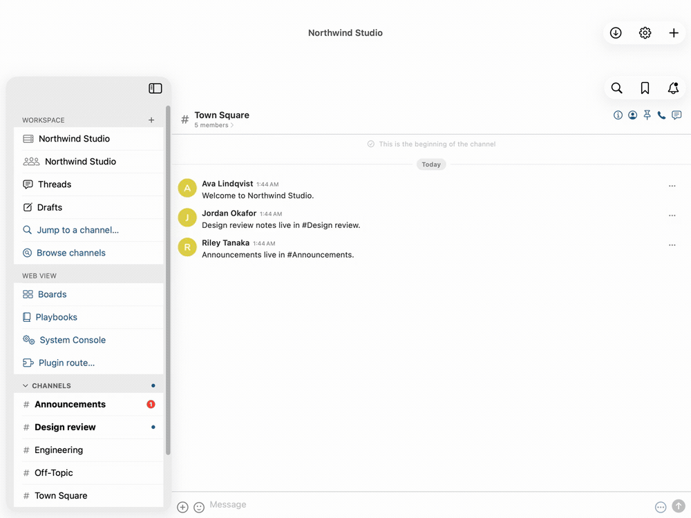

<h1>&nbsp;&nbsp;Mattermost for Mac &amp; iOS</h1>

[](https://github.com/yanksyoon/mattermost-ios/releases)
[](https://github.com/yanksyoon/mattermost-ios/actions/workflows/release.yml)
[](https://github.com/yanksyoon/mattermost-ios)
[](README.md#licence)

> **November 2026**: the whole workspace is native. Sidebar, channel timeline, composer, threads, search, activity and channel info are SwiftUI over the REST and WebSocket APIs; the webview is left only for the places where the server's own web bundle is the only renderer — SSO, Boards, Playbooks and the System Console.

A native **macOS and iOS client for Mattermost** — Swift and SwiftUI, not a web app in a window.

Your server already ships a good client: its own web app. This project keeps that as the source of
truth for the protocol and the behaviour, and renders the workspace natively on Apple platforms: a
30.6 MB download with no Chromium or Node bundled, Keychain-backed sessions, native notifications,
native scrolling, text selection and keyboard handling. It is an **unofficial personal build**,
not affiliated with Mattermost, Inc.; it signs in to your own server and reloads nothing through a
third party.

<picture>
  <source media="(prefers-color-scheme: dark)" srcset="docs/media/demo/native-demo-dark.gif">
  <source media="(prefers-color-scheme: light)" srcset="docs/media/demo/native-demo.gif">
  
</picture>

23 seconds of the iPhone build against a local test server, cut from one continuous take — launch →
unread sidebar → channel → thread → reply → back. [Watch the MP4](docs/media/demo/native-demo.mp4)
(muted, device resolution) · [still frame](docs/media/demo/poster.png) · [how it was recorded](docs/media/demo/README.md)

> **Start here:** [`docs/quickstart.md`](docs/quickstart.md) — build it, sign in, and read a
> channel, with every command that was actually run on the build host. Per-platform details:
> [`docs/installing.md`](docs/installing.md).

## Context: the Electron client

Mattermost's official desktop app is Electron: a Chromium renderer plus a Node main process. Its
macOS arm64 download is 129 MB (6.3.2) before it has loaded a single message. That is a fair trade
for one codebase across three operating systems. This project makes the other trade — one platform
family, everything native — and spends the saved weight on the things a Mac or iPhone app is
expected to get for free: Keychain credentials, system notifications, native text and gestures,
and a bundle that launches without booting a second runtime.

## Why native

Every row is shipped behaviour with a test or a benchmark behind it — nothing on this page is a
plan. The right-hand column describes the official web/Electron client (6.3.2); where the behaviour
is deliberately identical, it says so.

| Task | This app | Web / Electron client |
|---|---|---|
| Download and install | 30.6 MB universal `.zip`, no runtime to bundle | 129 MB macOS arm64 `.dmg` — Chromium + Node included |
| Draw the workspace | SwiftUI and UIKit, driven by REST v4 + WebSocket v4; one WebKit view only for SSO, Boards, Playbooks and the System Console | the web app, rendered by Chromium |
| Reply in a thread | native thread pane: reply, follow, load earlier, open in channel; Back returns to wherever you came from | the same Mattermost thread UI, in the web renderer |
| A mention while the app is open | native local notification, click-through to the channel, badge on the app icon | the web app's notification path inside Electron |
| Send a message | Return sends, Shift+Return inserts a newline | same — deliberately; the web app's shortcut is the spec |
| A self-signed or enterprise server | native trust sheet naming subject, issuer and SHA-256 fingerprints; the decision is remembered per server | the client's own certificate handling |
| Two servers at once | one isolated cookie store and one Keychain entry per server | one session partition per server |

## Install

**macOS, prebuilt (about a minute).** Download `Mattermost-macOS-<tag>.zip` from
[Releases](https://github.com/yanksyoon/mattermost-ios/releases), drag `Mattermost.app` to
`/Applications`, then clear the download quarantine once — the build is ad-hoc signed and not
notarised, so Gatekeeper refuses the first launch:

```bash
xattr -dr com.apple.quarantine /Applications/Mattermost.app
open -a /Applications/Mattermost.app
```

No terminal: try opening it once, then **System Settings → Privacy & Security → Open Anyway**.

**macOS, from source (Xcode, no Apple account).** A Release product must be re-signed before it
launches: Xcode signs Release with the hardened runtime, and the embedded WebRTC framework is
ad-hoc with no Team ID, so dyld refuses the mapping and the process dies about two seconds after
`open` returns. (Debug builds launch as-is; the re-sign is harmless there too.)

```bash
xcodebuild -project Mattermost.xcodeproj -scheme Mattermost -configuration Release \
  -destination 'platform=macOS,variant=Mac Catalyst' -derivedDataPath build/ddata-mac-release build
codesign --force --deep --sign - build/ddata-mac-release/Build/Products/Release-maccatalyst/Mattermost.app
open build/ddata-mac-release/Build/Products/Release-maccatalyst/Mattermost.app
```

**iOS, from source.** The prebuilt releases are macOS only. Open `Mattermost.xcodeproj`, choose
your Team under *Signing & Capabilities* (a free Apple ID works; its profile expires every 7 days),
pick your device and Run. A physical device also needs **Developer Mode** (Settings → Privacy &
Security → Developer Mode) and must trust your certificate afterwards. There is no App Store build
and no paid Developer Program involved.

## Quick start

1. **Install** — the release zip, or Xcode Run (above).
2. **Launch** the app; a welcome pager opens on first run.
3. **Add your server and sign in** — the full `https://` URL is checked against `/api/v4/system/ping` before it is saved; SSO opens its IdP pop-up in the app and hands custom-scheme redirects back, and username/password plus MFA work too.
4. **Pick a workspace** — a server can host several teams; the picker remembers which one each server was last on.
5. **Open a channel** — unread and mention counts are in the sidebar; threads open beside the timeline.

## Performance

Measured against the official desktop client — see [`docs/perf/`](docs/perf/).

<!-- TODO(t_dc1ea1fa): the concise native-vs-Electron benchmark table lands here. No numbers are
     claimed on this page until that run measures both clients signed in to the same workspace;
     docs/perf/2026-11-05-native-vs-electron.md records a blocked run that measured nothing. -->

## Parity

160 capabilities of the Mattermost desktop and mobile clients are mapped one-for-one against the
pinned upstream `v2.45.0`: **135 implemented**, 2 partial, 16 not yet implemented, 7 out of scope.
Each row names the test or recorded observation that backs it — [docs/PARITY.md](docs/PARITY.md).

## Roadmap

- **Mentions that arrive when the app is closed** — local notifications work while the app runs; delivery needs an Apple Developer Program membership and a hosted Mattermost Push Proxy.
- **Channel bookmarks and scheduled posts** — waiting on a licensed server to build and test against; the open-source fixture answers 404 on both.
- **A signed, notarised download** — so the first launch stops explaining Gatekeeper, plus an App Store release and a phased rollout.
- **A published benchmark page** — native vs the official client, refreshed on every release; the first run is blocked and its numbers are not published.

## Development

```bash
scripts/qa-test.py                 # iOS simulator, whole scheme (unit + UI)
scripts/qa-test.py --platform mac  # Mac Catalyst, MattermostTests
```

Surfaces flip to native one at a time, each with the webview as its fallback — the switch, the
approval ledger and the measurements are in [docs/dual-render.md](docs/dual-render.md). Screen
inventory: [docs/component-map.md](docs/component-map.md). The parity record is generated from
`docs/parity/module-scan.tsv` and `parity/claims.tsv` by `parity/generate.py`.

How this client got here — the port from the Electron shell, in the original README's words:
[docs/migration.md](docs/migration.md).

## Contributing

It is a personal build, shared because it was useful. Bug reports with a reproduction are welcome;
the most useful patch is a parity row plus the test that proves it, because that is the only kind
of claim this project accepts.

## Licence

Personal project: there is no license file, so all rights are reserved. The Swift shell in this
repository is original work; the Mattermost web app served by your instance remains Mattermost's
code and is not redistributed here. Third-party components and their licences:
[NOTICE](NOTICE) and [docs/THIRD_PARTY_NOTICES.md](docs/THIRD_PARTY_NOTICES.md).

Not affiliated with Mattermost, Inc. "Mattermost" is their trademark; this is a personal client
that talks to Mattermost servers.
